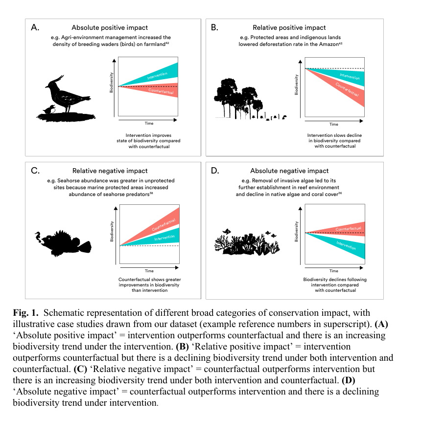

## Would you restrict drone flights near nesting birds?

A reserve manager asks whether drone flights should be restricted near breeding colonies.

- Which birds and sites have been studied?
- Do flights affect behaviour or breeding success?
- What evidence would justify a restriction at this reserve?

::: notes
0–5 min. Ask students to put the evidence they would want first in the Teams chat. Read two contrasting answers aloud. The questions on the slide are related but call for different outputs. Use this scenario throughout.
:::

## What makes a synthesis useful?

- It answers a question that someone needs answered.
- It explains how evidence was found, selected and interpreted.
- It shows how study limitations and context affect the conclusion.

::: notes
Introduce the lecture as a 45-minute teaching session including chat activities, with optional Q&A afterwards. A single study may be informative, while a synthesis can show how its findings sit alongside the rest of the evidence. Ask whose decision the synthesis is intended to inform.
:::

## Choose by the output you need

| What do you need? | Approach | Typical output |
|------------------------|------------------------|------------------------|
| Clarify what a broad topic covers | Scoping review | Concepts, definitions and types of evidence |
| Locate evidence clusters and gaps | Systematic map | Searchable study database and summaries of coverage |
| Answer a defined question | Systematic review | Appraised findings and their limitations |
| Estimate an effect across comparable studies | Systematic review with Meta-analysis | Pooled estimate, uncertainty and variation |
| Answer a defined question under a deadline | Rapid review | Focused synthesis with explicit restrictions |

::: notes
5–24 min for the approaches and workflow. Ask students to start with the middle column only after deciding what they need in the left column. The labels overlap in practice, especially scoping review and systematic map. Meta-analysis is an analytical method within a review. Rapid describes a way of conducting a review under constraints. Briefly mention that qualitative evidence synthesis may be appropriate for questions about experience or implementation, such as why recreational drone users comply with restrictions.
:::

## Scoping review or systematic map?

### Scoping review

**How is drone disturbance defined and measured in bird studies?**

Describe concepts, definitions, outcome measures and types of evidence.

### Systematic map

**Which bird groups, settings and outcomes have been studied in relation to drone disturbance?**

Code each study into a searchable database. Show where studies cluster and where few were found.

::: notes
Both can use explicit searches and eligibility criteria. Scoping reviews can also map evidence. The teaching distinction is the intended output. In environmental evidence, a systematic map typically provides a structured inventory and visual summaries. A cell with many studies describes coverage. To infer an effect, you need the studies’ results and an appraisal of their validity. Few studies in a cell may reflect limited evidence or limitations of your search.
:::

## Systematic review

**What effect do recreational drone flights have on nest attendance in colonial seabirds compared with no flights?**

| Question element | Example                                     |
|------------------|---------------------------------------------|
| Population       | Breeding colonial seabirds                  |
| Exposure         | Recreational drone flights                  |
| Comparator       | Comparable periods or sites without flights |
| Outcome          | Time adults spend attending the nest        |

::: notes
Introduce PECO as a tool for structuring questions about exposures. Ask what counts as a comparable no-flight period. Tide, weather, time of day, colony identity and breeding stage could differ systematically. The question informs both eligibility and the eventual claim. Appraise study validity and combine findings in a way that fits the available data.
:::

## When can you pool results?

- Do the estimates address a shared question?
- Can you express them on a defensible common scale?
- Can you quantify their uncertainty and account for dependence?
- Would a pooled estimate be interpretable across these settings?

**Nest attendance, flushing distance and fledging success answer different questions.**

::: notes
An effect size is an estimate of a contrast, with uncertainty. Repeated flights from one colony and multiple estimates from one paper may be dependent. Variation may reflect species, flight altitude or breeding stage. A random-effects model allows variation in underlying effects, but meaningful pooling still requires a coherent estimand. A pooled mean can be unhelpful for predicting effects at a specific site.
:::

## A systematic review can synthesise without pooling

- Group studies by outcome, design and setting.
- Tabulate effect estimates and uncertainty where available.
- Explain how bias and differences among studies affect interpretation.

**A tally of statistically significant results depends on study precision and sample size.**

::: notes
Give a hypothetical example of two studies that estimate similar changes in nest attendance with very different precision. Counting significance treats their results as different even though the point estimates agree. A structured synthesis can present both estimates alongside design, uncertainty and context. Ask students what the two studies would contribute if one compared different colonies and the other used matched periods at the same colony.
:::

## When time is limited

**The reserve manager needs a briefing in six weeks.**

- Narrow the question to a decision-relevant population and outcome.
- Specify any limits on sources, dates or languages in advance.
- Explain what those limits could miss.

::: notes
Distinguish a narrower question from a shortcut in searching or screening. A tightly scoped review can retain full methods within its scope. A rapid review streamlines specified steps. For example, omitting agency reports may miss site-specific monitoring. For an MSc, pilot the search and a sample of screening and extraction before promising a scope. Check for an existing review you can update or build on.
:::

## From question to conclusion

1.  Define the question and write a protocol.
2.  Search relevant sources and record how you searched.
3.  Screen using explicit eligibility criteria.
4.  Extract data and appraise study validity as appropriate to the aim.
5.  Synthesise and report findings, uncertainty and limitations.

::: notes
Retain the original VKM workflow here. Emphasise that a map primarily codes study characteristics and detailed critical appraisal is optional under CEE mapping guidance. For an effect review, appraisal informs interpretation. Keep a record of changes to the protocol and explain the reasons. CEE provides conduct guidance and ROSES provides reporting forms.
:::

## Exercise

**Which approach would you choose, and what would you deliver?**

**A.** A research funder wants to know which species and outcomes have been studied.

**B.** A reserve manager wants to know whether flights reduce nest attendance.

**C.** A student wants to know how researchers define and measure disturbance.

Pick one. Post your approach and its intended output in the chat.

::: notes
24–30 min. Give 60 seconds to think and ask students to send together. Read two or three answers aloud. Ask what each output would let its audience conclude. If a student suggests meta-analysis for B, ask what they would need to know about the studies first. If they suggest a map for C, ask whether the output is a coded inventory or a synthesis of how concepts are used. Accept a defensible answer if the approach matches the output.
:::

## Exercise debrief

| Scenario | Starting approach | What you would deliver |
|------------------------|------------------------|------------------------|
| A · Research funder | Systematic map | Study database and coverage by taxon and outcome |
| B · Reserve manager | Systematic review | Appraised findings on nest attendance, pooled if justified |
| C · MSc student | Scoping review | Account of definitions and how outcomes are measured |

**What would you need to know before applying B to your reserve?**

::: notes
Look for flight protocols, species, breeding stage, local conditions and whether the outcome matters for the decision. Reduced nest attendance and reduced breeding success are distinct claims. Site policy also depends on practical options, potential harms and the consequences of uncertainty.
:::

## Does conservation work?

::: claim
“In two-thirds of cases, conservation either improved the state of biodiversity or at least slowed declines.”
:::

::::::::::: columns
:::: {.column width="25%"}
::: stat
Science
:::

published in 2024
::::

:::: {.column width="25%"}
::: stat
186
:::

included studies
::::

:::: {.column width="25%"}
::: stat
665
:::

intervention trials
::::

:::: {.column width="25%"}
::: stat
7
:::

intervention types
::::
:::::::::::

::: notes
Introduce only the information visible here. The paper describes a global meta-analysis comparing temporal biodiversity outcomes under conservation action with counterfactual outcomes. Do not yet discuss selection, study validity or the meaning of a trial.

\[Sources\] - Langhammer PF et al. 2024. The positive impact of conservation action. Science 384:453–458. https://doi.org/10.1126/science.adj6598 \[/Sources\]

Timing: 3 minutes.
:::

------------------------------------------------------------------------

## How convincing is the conclusion?

### Does this evidence show that conservation works?

::::::: columns
::: {.column width="25%"}
**A**\
Very confident
:::

::: {.column width="25%"}
**B**\
Fairly confident
:::

::: {.column width="25%"}
**C**\
Uncertain
:::

::: {.column width="25%"}
**D**\
Not confident
:::
:::::::

::: notes
Ask for a show of hands. Record the rough distribution, but do not discuss the study yet. Say: “Keep hold of that judgement—we will return to it.”

Timing: 5 minutes.
:::

------------------------------------------------------------------------

## What else would you need to know?

::: big-question
Before accepting—or rejecting—the conclusion, what information would most change your confidence?
:::

Write down one question.

::: notes
Collect questions without answering them. Likely requests include the search and eligibility criteria, representativeness, publication processes, credibility of counterfactuals, primary-study risk of bias, independence of trials, outcome harmonisation and heterogeneity. Group responses under study validity, synthesis validity and generalisability.

\[Sources\] - Langhammer et al. 2024. https://doi.org/10.1126/science.adj6598 \[/Sources\]

Timing: 5 minutes.
:::

------------------------------------------------------------------------

## What initially influenced you?

::: big-question
The journal?\
The word “global”?\
The number of studies?\
The meta-analysis?\
A conclusion you wanted to be true?
:::

::: notes
Take three or four responses. Surface the difference between reasons for trusting a source and evidence that directly supports the inference. Do not imply that prestige or scale are irrelevant; they are simply not substitutes for appraisal.

Timing: 3 minutes.
:::

## What does the meta-analysis add?

- The authors estimated the **average standardised effect** across the included comparisons.
- They reported **confidence intervals** for the overall estimate and estimates by intervention class.
- Several comparisons could come from the same study. The analysis modelled their clustering within studies.

##

::: notes
Use panel A. Point to zero, the overall estimate and its confidence interval. Ask what an estimate to the right of zero means. It favours action on average for that group. A confidence interval around the mean describes uncertainty in the mean, while predicting an effect at a new site requires information about variation and relevance. The intervention-class rows show pooled estimates, rather than individual study estimates. A systematic map of these studies could show coverage by intervention, region and outcome.
:::

## Would you expect the same benefit at your site?

A manager says, “Our new restoration project has a two-thirds chance of succeeding.” How would you revise that claim?

- Which interventions and outcomes are comparable to the proposed project?
- How similar are the ecological settings and baseline threats?
- How credible are the counterfactuals in the most relevant studies?

::: notes
38–40 min. Ask for a one-sentence rewrite. Example: Across the comparisons included in the study, conservation often improved biodiversity trajectories relative to the counterfactual. To judge this project, we would look for evidence from comparable restoration actions and sites. Mention that coverage was uneven across regions and intervention types. Transition to AI by asking what an AI summary might omit if it reported only the headline.
:::

## How were the 665 trials classified?

| Outcome relative to the counterfactual | Trials |
|---|---:|
| Biodiversity improved under conservation | **45.4%** |
| Biodiversity declined more slowly | **20.6%** |
| Biodiversity declined more under intervention | **20.6%** |
| Biodiversity improved more under the counterfactual | **11.6%** |
| No difference | **1.8%** |

::: {.claim}
Is “two-thirds of trials” an effect estimate, a vote count—or a descriptive classification?
:::

::: notes
The first two categories sum to 66%. Ask what information the classification discards: magnitude, precision, study validity, context and dependence. Do not imply that the paper relied only on this classification; it also reported a quantitative meta-analysis.

[Sources]
- Langhammer et al. 2024. https://doi.org/10.1126/science.adj6598
[/Sources]

Timing: 6 minutes.
:::

## Which conservation evidence entered the synthesis?

- A **Rapid Evidence Assessment** retrieved 1,445 English-language publications.
- Only 186 supplied temporal intervention–counterfactual comparisons that could be converted to the chosen effect size.
- **95 of 186 studies** came from Western Europe, North America, Australia and New Zealand.
- Protected areas and invasive/problematic species control contributed **63%** of the included studies.
- Multiple metrics or species from one study could contribute separate trials, modelled as nested within studies.
- [Also the reported Hedges g is implausible]

::: notes
Ask which statements bear on internal validity, external validity, precision or synthesis-level selection. The authors conducted sensitivity analyses for nesting and a supplemental search. Avoid calling the 665 trials simple pseudoreplication.

[Sources]
- Langhammer et al. 2024. Main text and supplementary methods. https://doi.org/10.1126/science.adj6598
[/Sources]

Timing: 6 minutes.
:::

---

## The evidence is useful—but the target matters

::: {.columns}
::: {.column width="48%"}
### More defensible

Among eligible, evaluated interventions, conservation often produced better biodiversity trajectories than the selected counterfactuals.
:::
::: {.column width="48%"}
### Not directly estimated

Conservation actions generally have a two-thirds probability of succeeding across actions, places, organisms and circumstances.
:::
:::

The synthesis estimates outcomes in the available evaluated comparisons—not every possible conservation action.

::: notes
This is the key generalisability and estimand point. The paper provides substantive evidence of beneficial action; the critique concerns the breadth and interpretation of the headline claim, not whether conservation can work.

[Sources]
- Langhammer et al. 2024. https://doi.org/10.1126/science.adj6598
[/Sources]

Timing: 5 minutes.
:::

---

## Vote again

### How confident are you that the study shows “conservation works”?

::: {.confidence-scale}
Very confident
Fairly confident
Uncertain
Not confident
:::

::: {.fragment .bottom-line}
Changing your mind when the evidential basis changes is good scientific judgement.
:::

::: notes
Repeat the vote. Ask people who moved in either direction what information changed their judgement. Distinguish confidence that conservation can be beneficial, confidence in the average result among included comparisons, and the probability that a new action will succeed.

[Sources]
- Langhammer et al. 2024. https://doi.org/10.1126/science.adj6598
[/Sources]

Timing: 5 minutes.
:::

---

## Before trusting a claim, pause

::: {.claim .accent}
Compared with what?
:::

::: {.claim .accent}
What else could produce this pattern?
:::

::: {.claim .accent}
What is genuinely replicated?
:::

::: {.claim .accent}
What is missing—and could it change the story?
:::

::: notes
These are the four questions to remember if CLAIM itself is forgotten.

Timing: 3 minutes.
:::

---

## AI in searching and screening

| Stage | Possible assistance | Failure to check for |
|------------------------|------------------------|------------------------|
| Searching | Suggest synonyms and testable database queries | Missed terminology, invented references and opaque coverage |
| Screening | Rank titles and abstracts for human review | Eligible studies ranked low, especially in less familiar subsets |

**Test searches against known eligible studies. Check lower-ranked records before considering any stopping rule.**

::: notes
30–40 min for AI. Distinguish a language model that drafts a query from a database that executes it. Test whether known eligible records are recovered and independently check search logic. Known records alone cannot establish search completeness. Distinguish prioritisation from automatic exclusion. If students propose stopping early, discuss comparison against independent human decisions and how they would check the residual records, including poorly represented languages or taxa. A streak of exclusions alone cannot establish recall.
:::

## AI in extraction and synthesis

| Stage | Possible assistance | Failure to check for |
|------------------------|------------------------|------------------------|
| Extraction | Suggest structured entries with page or table references | Wrong unit, denominator, comparator or sample size |
| Synthesis | Draft text from a verified evidence table | Causal overstatement, flattened differences or unsupported claims |

**Trace extracted values and substantive claims back to the evidence.**

::: notes
Ask students to request the source location for each field and compare it against the full text. A page citation is a pointer that still needs verification. Use the original results and approved analysis to establish claims. Appraisal and interpretation remain the research team’s responsibility.
:::

## Spot the extraction error

**Hypothetical paper:** Twelve colonies each received two drone flights. Nest attendance was recorded after each flight.

**AI extraction:** Sample size = 24 independent colonies.

What would you correct, and what would you check next?

::: notes
Give 45 seconds. There are 12 colonies and 24 flights, with repeated observations within colonies. Check the actual design, comparator, unit of allocation, analytical model and reported uncertainty. The excerpt alone does not establish the appropriate effective sample size or whether colonies are independent. Treating all flights as independent can make uncertainty look smaller than warranted.
:::

## Decide how you will check AI assistance

- Define the specific task and what a consequential error would be.
- Compare outputs with independently checked examples from your review.
- Decide which outputs require human verification.
- Record the tool, version, role, checks and how errors were handled.

**The review team is accountable for the methods and findings.**

::: notes
Connect this to RAISE and the joint Cochrane, Campbell, JBI and CEE position statement. A benchmark should include difficult cases as well as routine examples. The checks need to match the consequence of error. If performance is inadequate or verification takes more effort than the task saves, do the step manually. For a student project, a small pilot in a clearly bounded step is easier to evaluate than automating an entire workflow.
:::

## Further reading

- [CEE Guidelines · Choosing a synthesis approach](https://collaborationenvironmentalevidence.github.io/CEE_guidelines/Chapter_2.html)
- [ROSES · Reporting systematic reviews and maps](https://environmentalevidence.org/roses/)
- [RAISE · Responsible AI use in evidence synthesis](https://osf.io/fwaud/overview)
- [Joint position statement on AI in evidence synthesis](https://link.springer.com/article/10.1186/s13750-025-00374-5)
